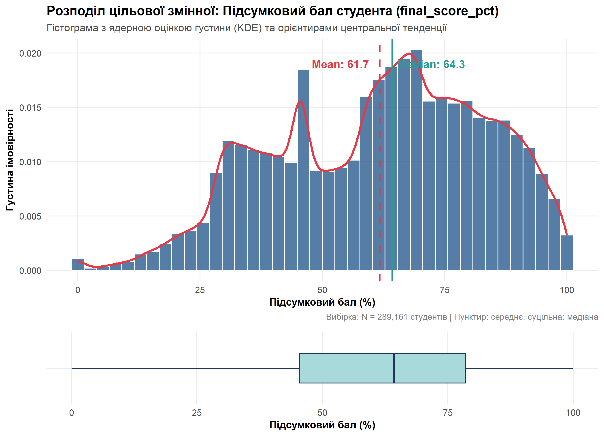
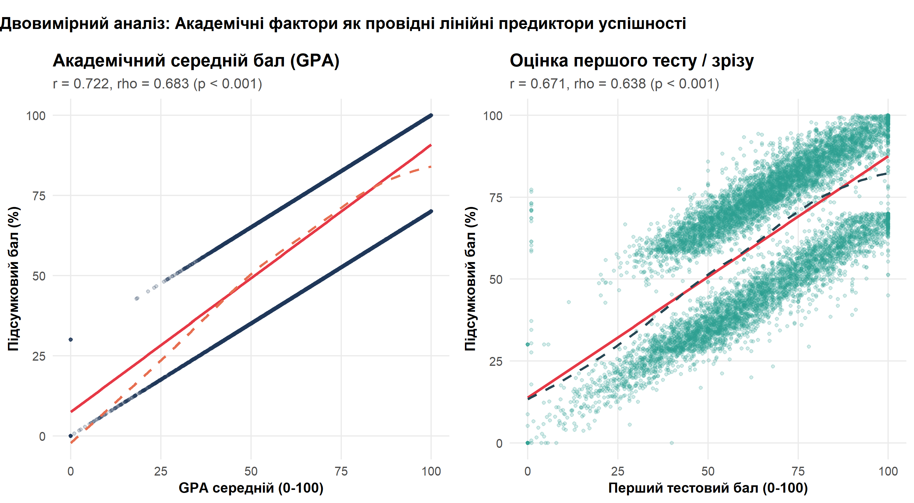
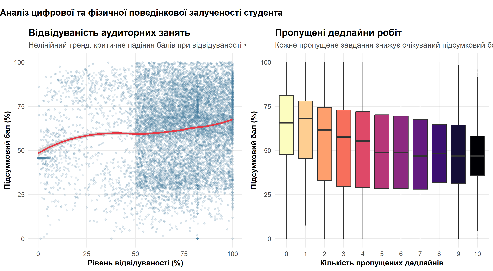
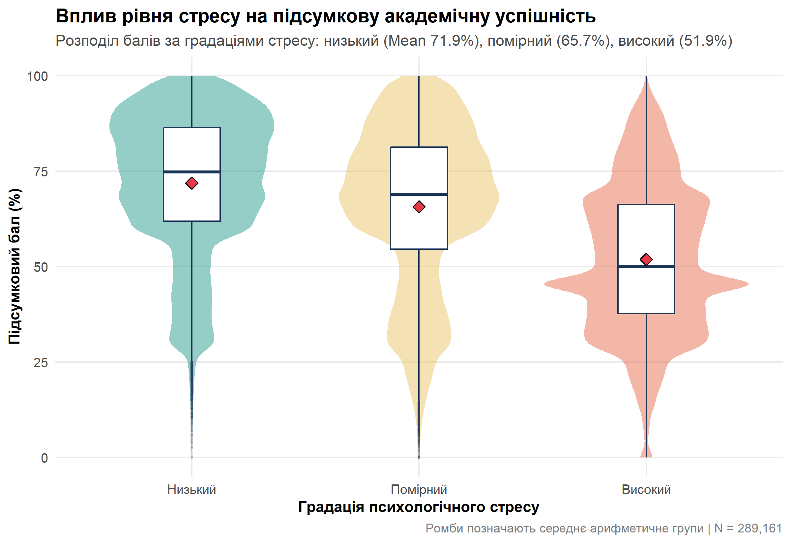
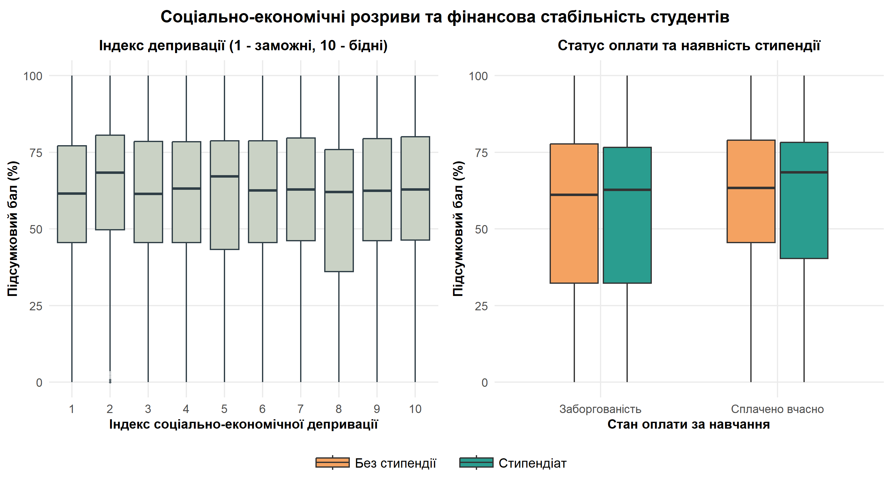
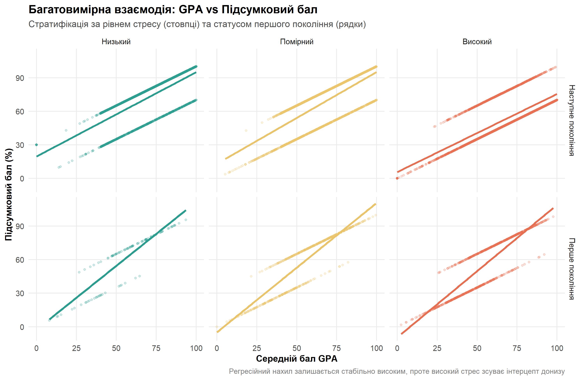
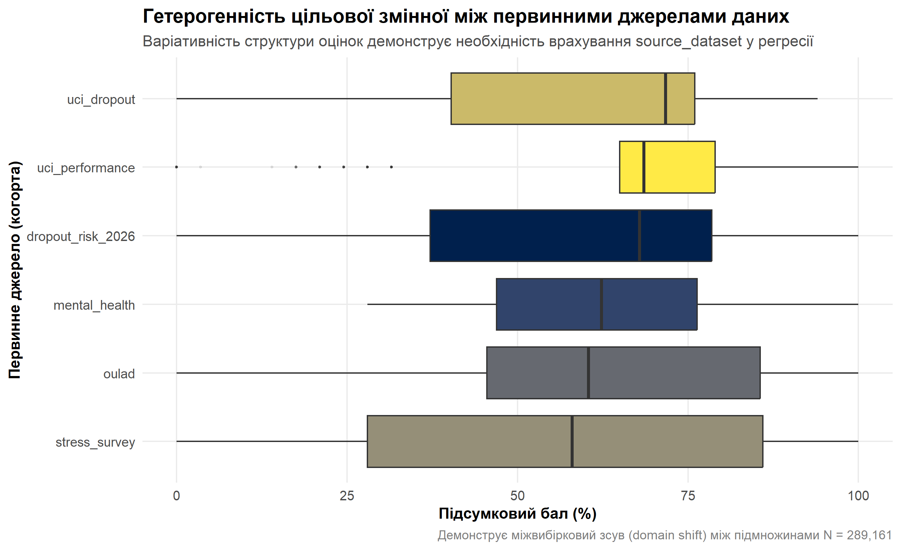

---
format:
  revealjs:
    theme: default
    transition: slide
    navigation-mode: linear
    controls: true
    keyboard: true
    overview: true
    slide-number: true
    toc: false
    center: false
    width: 1280
    height: 720
    margin: 0.05
    embed-resources: true
    css: presentation_style.css
---

## {text-align="center"}

::::: {.title-container}
[Раннє виявлення стресу та академічного дистресу у студентів]{.title-main}

[Лабораторна робота №2]{.title-sub}

[Виконала: Садовик Аліна, група АтаВДвR-11]{.title-author}
:::::

---

## 01. Мета та дослідницькі запитання

:::: {.kpi-container}
::: {.kpi-box}
[289,161]{.kpi-val}
[Студентських записів]{.kpi-title}
:::
::: {.kpi-box}
[6]{.kpi-val}
[Відкритих когорт]{.kpi-title}
:::
::: {.kpi-box}
[final_score_pct]{.kpi-val}
[Неперервна ціль (0–100%)]{.kpi-title}
:::
::::

:::::: {.columns}
::::: {.column width="48%"}
:::: {.card}
[01. Мета дослідження]{.card-title}

Комплексний EDA багатовимірного бенчмарку **Learning Analytics**: дослідження взаємозв'язку між академічною успішністю, активністю у VLE/LMS, стресом і способом життя для підготовки надійного фундаменту регресійного аналізу.
::::
:::::

::::: {.column width="52%"}
:::: {.card}
[02. Дослідницькі запитання]{.card-title}

- **RQ1 (Академічний бекграунд):** Чи є рання успішність (GPA, тест) надійним лінійним предиктором?
- **RQ2 (Залученість до VLE/LMS):** Чи існують критичні порогові ефекти у відвідуваності та дедлайнах?
- **RQ3 (Психічне здоров'я):** Як стрес, вигорання та сон деформують результативність?
- **RQ4 (Соціальна нерівність):** Які розриви спричиняють депривація та статус 1-го покоління?
::::
:::::
::::::

---

## 02. Характеристика даних та цільова змінна

:::::: {.columns}
::::: {.column width="48%"}
:::: {.card}
[01. Три треки даних (N = 289,161)]{.card-title}

- [Track 1]{.badge} **Академічна оцінка & VLE/LMS:** GPA, тренд, тест, активні дні, запізнення, пропущені дедлайни, відвідуваність.
- [Track 2]{.badge} **Психоемоційний стан:** шкала стресу (0-10), тривожність, депресія, вигорання, сон, соц. підтримка.
- [Track 3]{.badge} **Соціо-демографія:** індекс депривації (1-10), перше покоління, стипендія, стан оплати за навчання.
::::
:::::

::::: {.column width="52%"}
:::: {.card}
[02. Обґрунтування регресії]{.card-title}

- **Неперервна числова шкала:** `final_score_pct` вимірює точний відсоток успішності ($0.00\% - 100.00\%$), а не мітку «склав/не склав».
- **Граничні ефекти:** дає змогу оцінити конкретний внесок кожної години сну чи додаткових відсотків відвідуваності.
- **Стохастична природа:** бал не є сумою стовпців, а формується під комплексним впливом багатьох факторів.
::::
:::::
::::::

---

## 03. Одновимірний аналіз: Розподіл `final_score_pct`

:::: {.kpi-container}
::: {.kpi-box}
[61.68%]{.kpi-val}
[Середній бал (Mean)]{.kpi-title}
:::
::: {.kpi-box}
[64.30%]{.kpi-val}
[Медіана (Median)]{.kpi-title}
:::
::: {.kpi-box}
[33.06%]{.kpi-val}
[Розмах IQR (Q1-Q3)]{.kpi-title}
:::
::: {.kpi-box}
[-0.421]{.kpi-val}
[Асиметрія (Skewness)]{.kpi-title}
:::
::::

:::::: {.columns}
::::: {.column width="56%"}
{width="100%"}
:::::

::::: {.column width="44%"}
:::: {.card}
[Аналітичні знахідки]{.card-title}

- Повний діапазон від **0 до 100%** без штучного стиснення чи відсікання.
- **Помірна лівостороння асиметрія:** відображає наявність групи студентів із хронічним академічним відставанням ($< 50\%$).
- **Пласковерхий розподіл ($Kurtosis = -0.643$):** висока варіативність вимагає врахування нелінійних залежностей.
::::
:::::
::::::

---

## 04. RQ1: Академічні фактори як лінійні предиктори

:::: {.kpi-container}
::: {.kpi-box}
[+0.722]{.kpi-val}
[GPA Avg (Pearson r)]{.kpi-title}
:::
::: {.kpi-box}
[+0.671]{.kpi-val}
[First Exam (Pearson r)]{.kpi-title}
:::
::: {.kpi-box}
[+0.117]{.kpi-val}
[Вступний бал (Admission)]{.kpi-title}
:::
::::

:::::: {.columns}
::::: {.column width="58%"}
{width="100%"}
:::::

::::: {.column width="42%"}
:::: {.card}
[Висновки за RQ1]{.card-title}

- **Поточний GPA** — найсильніший лінійний предиктор ($r = 0.722, \rho = 0.683, p < 0.001$).
- **Перший модульний тест** є раннім і надійним маркером для завчасної діагностики проблем.
- **Вступний шкільний бал** має слабкий зв'язок ($r = 0.117$): поточна семестрова динаміка витісняє минулі оцінки.
::::
:::::
::::::

---

## 05. RQ2: Поведінкова залученість до VLE/LMS та пороги

:::: {.kpi-container}
::: {.kpi-box}
[&lt; 40%]{.kpi-val}
[Критичний поріг відвідуваності]{.kpi-title}
:::
::: {.kpi-box}
[-0.236]{.kpi-val}
[Пропущені дедлайни (r)]{.kpi-title}
:::
::: {.kpi-box}
[-4...-6 б.]{.kpi-val}
[Втрата за кожен пропуск]{.kpi-title}
:::
::::

:::::: {.columns}
::::: {.column width="58%"}
{width="100%"}
:::::

::::: {.column width="42%"}
:::: {.card}
[Висновки за RQ2]{.card-title}

- **LOESS-згладжування:** падіння відвідуваності **нижче 40%** призводить до стрімкого провалу очікуваного балу ($< 45\%$).
- **Ефект насичення:** при відвідуваності $> 70\%$ темп зростання балу сповільнюється.
- **Пропущені дедлайни:** студенти з $> 2$ пропусками рідко долають поріг успішності.
::::
:::::
::::::

---

## 06. RQ3: Психоемоційний стан, стрес та сон

:::: {.kpi-container}
::: {.kpi-box}
[71.91%]{.kpi-val}
[Низький стрес (Mean)]{.kpi-title}
:::
::: {.kpi-box}
[65.68%]{.kpi-val}
[Помірний стрес (Mean)]{.kpi-title}
:::
::: {.kpi-box}
[51.91%]{.kpi-val}
[Високий стрес (Mean)]{.kpi-title}
:::
::: {.kpi-box}
[-20.0%]{.kpi-val}
[Розрив успішності]{.kpi-title}
:::
::::

:::::: {.columns}
::::: {.column width="54%"}
{width="100%"}
:::::

::::: {.column width="46%"}
:::: {.card}
[Висновки за RQ3]{.card-title}

- **Колосальний розрив у 20 балів:** високий хронічний стрес та вигорання ($r = -0.350$) виступають головними деструкторами навчання.
- **Мультиколінеарність:** тривожність, депресія та вигорання мають взаємну кореляцію $r > 0.85$.
- **Режим сну:** оптимум становить $6.5 - 8$ год/добу; хронічний недосип ($< 5$ год) підсилює вигорання.
::::
:::::
::::::

---

## 07. RQ4: Соціально-економічні бар'єри та нерівність

:::: {.kpi-container}
::: {.kpi-box}
[-7.0%]{.kpi-val}
[Заборгованість з оплати]{.kpi-title}
:::
::: {.kpi-box}
[-5.0%]{.kpi-val}
[Розрив 1-го покоління]{.kpi-title}
:::
::: {.kpi-box}
[+7.5%]{.kpi-val}
[Стипендіальний бонус]{.kpi-title}
:::
::::

:::::: {.columns}
::::: {.column width="58%"}
{width="100%"}
:::::

::::: {.column width="42%"}
:::: {.card}
[Висновки за RQ4]{.card-title}

- **Фінансова стабільність:** заборгованість з оплати знижує середній бал з $62.2\%$ до $55.3\%$.
- **Індекс депривації (1–10):** медіанний бал стабільний (~$63\%$), соціальне походження саме по собі не обмежує успіх.
- **Стипендіальний бонус:** студенти зі стипендією та вчасною оплатою досягають найвищих балів (медіана ~$70\%$).
::::
:::::
::::::

---

## 08. Багатовимірна взаємодія та мультиколінеарність

:::::: {.columns}
::::: {.column width="55%"}
{width="100%"}
:::::

::::: {.column width="45%"}
:::: {.card}
[Мультифакторні закономірності]{.card-title}

- **Стабільність регресійного нахилу:** кут нахилу зв'язку між GPA та Final Score залишається високим в усіх групах.
- **Паралельний зсув інтерцепту:** високий стрес зсуває пряму регресії донизу незалежно від статусу покоління.
- **Вимога регуляризації:** через високу колінеарність психологічних шкал рекомендовано використовувати **Ridge / ElasticNet** або єдиний індекс дистресу.
::::
:::::
::::::

---

## 09. Гетерогенність когорт та ефект Сімпсона

:::::: {.columns}
::::: {.column width="55%"}
{width="100%"}
:::::

::::: {.column width="45%"}
:::: {.card}
[Міжвибірковий зсув (Domain Shift)]{.card-title}

- **Варіація за джерелами:** у когортах OULAD та UCI кореляція GPA сягає $r = 0.80 - 0.94$, тоді як у загальному масиві вона дещо згладжується ($0.72$).
- **Парадокс Сімпсона:** ігнорування фактора `source_dataset` може спотворити оцінки коефіцієнтів регресії.
- **Рішення для моделі:** включення джерела як фіксованого або випадкового ефекту (Mixed Models).
::::
:::::
::::::

---

## 10. Підсумкові висновки та рекомендації

:::::: {.columns}
::::: {.column width="50%"}
:::: {.card}
[01. Топ-інсайти дослідження]{.card-title}

- **Провідні рушії успіху:** поточний GPA ($r = 0.72$) та перший тестовий зріз ($r = 0.67$).
- **Головний деструктор:** хронічний стрес і вигорання (розрив у $20.0\%$).
- **Червоні прапорці ризику:** відвідуваність $< 40\%$ або $> 2$ пропущені дедлайни.
- **Соціальні фактори:** заборгованість та перше покоління ($-5...-7\%$).
::::
:::::

::::: {.column width="50%"}
:::: {.card}
[02. Рекомендації для регресії]{.card-title}

- **Регуляризація:** **ElasticNet / Lasso** для усунення мультиколінеарності симптомів стресу.
- **Нелінійність:** моделі **GAM** або ансамблі дерев (**Random Forest / XGBoost**) для порогових ефектів.
- **Готовність артефактів:** очищений датасет збережено в `clean_data.csv`, повна реплікація готова.
::::
:::::
::::::
