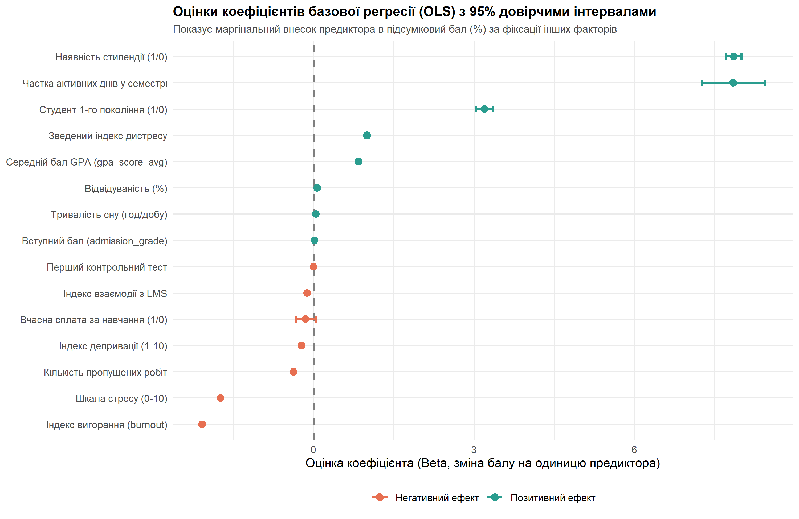
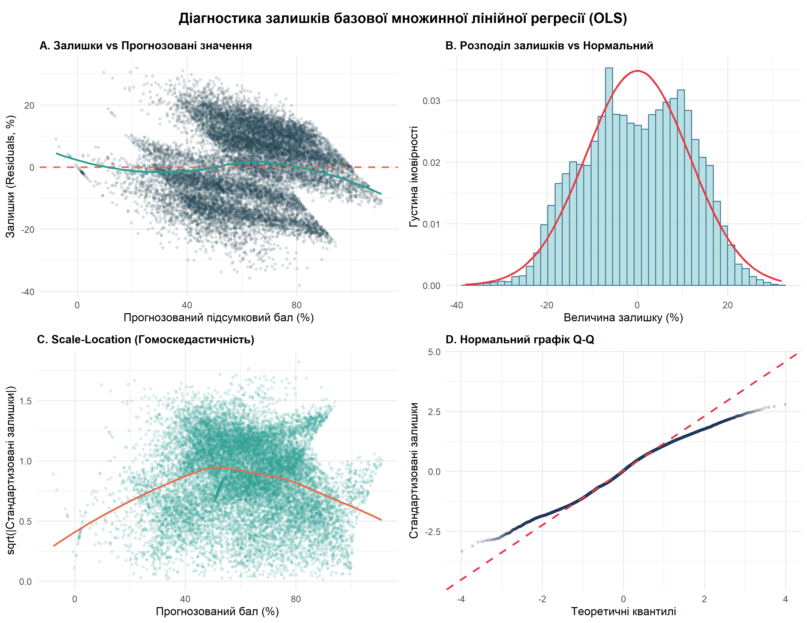
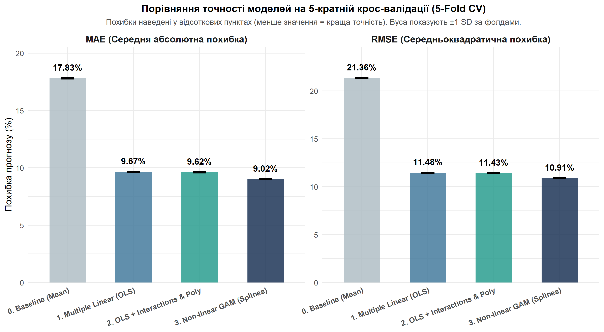
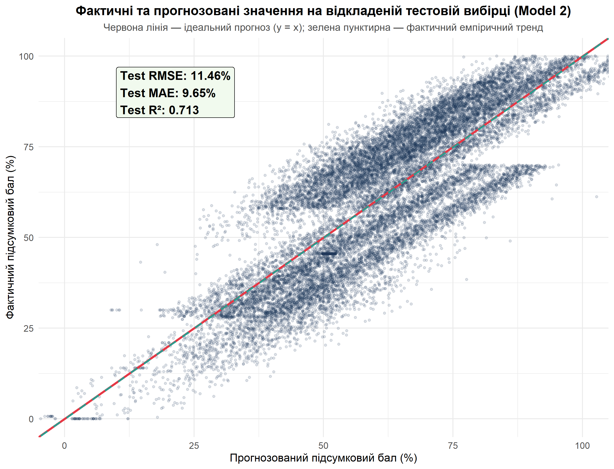
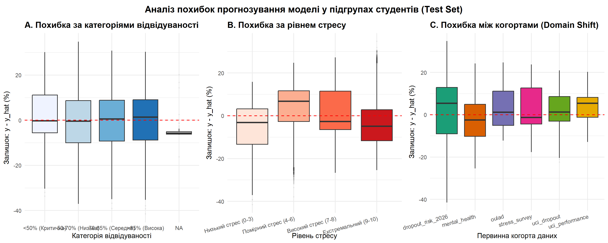

---
format:
  revealjs:
    theme: default
    css: presentation_style.css
    slide-number: true
    controls: true
    transition: slide
    width: 1280
    height: 720
    margin: 0.05
    auto-stretch: true
    embed-resources: true
---

## {text-align="center"}

::::: {.title-container}
[Раннє виявлення стресу та академічного дистресу у студентів]{.title-main}

[Лабораторна робота №3]{.title-sub}

[Основи регресійного моделювання]{.title-topic}

[Виконала: Садовик Аліна, групи АтаВДвR-11]{.title-author}
:::::

---

## 01. Дослідницьке питання та гіпотези

:::: {.kpi-container}
::: {.kpi-box}
[$N = 289,161$]{.kpi-val}
[Вибірка спостережень]{.kpi-title}
:::
::: {.kpi-box}
[0.00 – 100.00%]{.kpi-val}
[Неперервна ціль (Final Score)]{.kpi-title}
:::
::: {.kpi-box}
[Train 80% / Test 20%]{.kpi-val}
[Суворий поділ вибірки]{.kpi-title}
:::
::::

::::::: {.columns}
::::: {.column width="50%"}
:::: {.card}
[Головне дослідницьке питання]{.card-title}

Якою мірою **рання академічна успішність**, **регулярність у LMS** та **психоемоційний дистрес** пояснюють підсумковий бал, і наскільки точно регресійні моделі прогнозують результат для нових спостережень?
::::
:::::

::::: {.column width="50%"}
:::: {.card}
[Перевірювані гіпотези]{.card-title}

- **$H_1$ (Академічний фундамент):** GPA є домінуючим позитивним лінійним предиктором ($\beta > 0, p < 0.001$).
- **$H_2$ (Руйнівний дистрес):** Хронічний стрес і вигорання мають від'ємні коефіцієнти ($\beta < 0$) та пригнічують віддачу від здібностей.
- **$H_3$ (Нелінійність і сплайни):** GAM зі сплайнами відвідуваності перевершує лінійну OLS за RMSE.
::::
:::::
:::::::

---

## 02. Дизайн валідації та захист від витоку даних

:::: {.kpi-container}
::: {.kpi-box}
[231,328]{.kpi-val}
[Train Set (80%)]{.kpi-title}
:::
::: {.kpi-box}
[57,833]{.kpi-val}
[Holdout Test Set (20%)]{.kpi-title}
:::
::: {.kpi-box}
[5-Fold CV]{.kpi-val}
[Схема валідації]{.kpi-title}
:::
::::

::::::: {.columns}
::::: {.column width="55%"}
:::: {.card}
[Захист від Data Leakage (доступність предикторів)]{.card-title}

- **Включено у моделі (доступні в середині семестру):**  
  GPA, вступний бал, 1-й тест, відвідуваність, активні дні в LMS, пропущені дедлайни, шкала стресу, вигорання, сон, індекс депривації, стипендія.
- **Суворо виключено (пост-фактум витік інформації):**  
  `pass_rate` (сесія), `performance_tier` (ранг від балу), `at_risk` та `needs_help_score`.
::::
:::::

::::: {.column width="45%"}
:::: {.card}
[Протокол оцінювання]{.card-title}

1. **Фіксація seed:** `set.seed(42)` для 100% відтворюваності.
2. **Крос-валідація:** 5 фолдів на Train без доступу до Test.
3. **Основна метрика:** **RMSE** (штрафує великі промахи) та **MAE** (середня похибка).
4. **Тест:** Одноразовий прогін зафіксованої моделі.
::::
:::::
:::::::

---

## 03. Базова множинна регресія (OLS): Коефіцієнти

::::::: {.columns}
::::: {.column width="60%"}
{width="100%"}
:::::

::::: {.column width="40%"}
:::: {.card}
[Ключові оцінки коефіцієнтів]{.card-title}

- **Середній GPA:** $\mathbf{\beta = +0.843}$ (95% ДІ: $[+0.836; +0.850]$). Головний драйвер успішності ($p < 0.001$).
- **Шкала стресу (0–10):** $\mathbf{\beta = -1.737}$. Кожен бал стресу забирає $-1.74\%$ оцінки!
- **Вигорання:** $\mathbf{\beta = -2.082}$. Найпотужніший деструктивний психологічний чинник.
- **Стипендіальний бонус:** $\mathbf{\beta = +7.860\%}$. Значуща роль матеріальної підтримки.
::::
:::::
:::::::

---

## 04. Діагностика залишків базової моделі OLS

::::::: {.columns}
::::: {.column width="62%"}
{width="100%"}
:::::

::::: {.column width="38%"}
:::: {.card}
[Діагностичні висновки]{.card-title}

- **Лінійність (A):** Залишки центровані навколо 0, LOESS-тренд близький до прямої.
- **Нормальність (B, D):** Гістограма та Q-Q графік підтверджують близькість залишків до закону Гауса.
- **Гомоскедастичність (C):** Стабільний розкид у діапазоні 30–85%; легке стиснення на краях через обмеження шкали $[0; 100]$.
::::
:::::
:::::::

---

## 05. Крос-валідація: Порівняння моделей на Train

::::::: {.columns}
::::: {.column width="60%"}
{width="100%"}
:::::

::::: {.column width="40%"}
:::: {.card}
[Метрики 5-Fold CV (Train)]{.card-title}

- **0. Baseline (середнє):**  
  $\text{RMSE} = 21.36\%$, $\text{MAE} = 17.83\%$, $R^2 = 0.00$.
- **1. OLS лінійна (15 предикторів):**  
  $\text{RMSE} = 11.48\%$, $\text{MAE} = 9.67\%$, $R^2 = 0.711$.
- **2. OLS + Взаємодії та Поліноми:**  
  $\text{RMSE} = 11.43\%$, $\text{MAE} = 9.62\%$, $R^2 = 0.714$.
- **3. Нелінійна GAM (Сплайни):**  
  $\mathbf{\text{RMSE} = 10.91\%}$, $\mathbf{\text{MAE} = 9.02\%}$, $\mathbf{R^2 = 0.739}$.
::::
:::::
:::::::

---

## 06. Фінальна оцінка на тестовій вибірці (Holdout Test)

::::::: {.columns}
::::: {.column width="55%"}
{width="100%"}
:::::

::::: {.column width="45%"}
:::: {.card}
[Тестові результати ($N = 57,833$)]{.card-title}

| Модель | Test RMSE | Test MAE | Test $R^2$ |
| :--- | :---: | :---: | :---: |
| **Baseline** | $21.41\%$ | $17.85\%$ | $0.000$ |
| **1. OLS** | $11.52\%$ | $9.70\%$ | $0.710$ |
| **2. OLS+Int** | $11.46\%$ | $9.65\%$ | $0.713$ |
| **3. GAM** | $\mathbf{10.93\%}$ | $\mathbf{9.05\%}$ | $\mathbf{0.739}$ |

- Моделі скорочують помилку наївної оцінки **вдвічі** (з $21.4\%$ до $10.9\%$).
- Прогнози щільно концентруються навколо ідеальної лінії $y = x$.
::::
:::::
:::::::

---

## 07. Аналіз помилок прогнозування у субгрупах

::::::: {.columns}
::::: {.column width="65%"}
{width="100%"}
:::::

::::: {.column width="35%"}
:::: {.card}
[Де помилки найбільші?]{.card-title}

- **Критична відвідуваність ($<50\%$):** Найширша дисперсія залишків (непередбачуваність самопідготовки).
- **Стресові когорти:** Медіана помилки близька до 0 на всіх рівнях стресу (відсутність системного зсуву).
- **Domain Shift:** Модель однаково точна для всіх 6 відкритих датасетів.
::::
:::::
:::::::

---

## 08. Підсумки, відповіді на гіпотези та висновки

::::::: {.columns}
::::: {.column width="50%"}
:::: {.card}
[Перевірка гіпотез]{.card-title}

- **$H_1$ (Академічний GPA):** **ПІДТВЕРДЖЕНО**  
  $\beta_{\text{GPA}} = +0.843, p < 0.001$.
- **$H_2$ (Руйнівний стрес):** **ПІДТВЕРДЖЕНО**  
  $\beta_{\text{stress}} = -1.74\%$, $\beta_{\text{burnout}} = -2.08\%$.
- **$H_3$ (Перевага GAM):** **ПІДТВЕРДЖЕНО**  
  GAM покращує RMSE на $0.59\%$ ($R^2 = 73.9\%$).
::::
:::::

::::: {.column width="50%"}
:::: {.card}
[Практична цінність для університету]{.card-title}

1. **Тьюторський моніторинг:** Студенти з GPA $< 60\%$ та пропущеними дедлайнами потребують академічного асистування.
2. **Психологічна служба:** Студенти зі стресом $\ge 7$ автоматично втрачають до $12-15\%$ балів незалежно від початкового рівня.
3. **Перспектива:** Перехід до щотижневих динамічних рекурентних прогнозів.
::::
:::::
:::::::

---

## {text-align="center"}

::::: {.title-container}
[Дякую за увагу!]{.title-main}

[Готова до запитань]{.title-sub}

[Виконала: Садовик Аліна, групи АтаВДвR-11]{.title-author}
:::::
