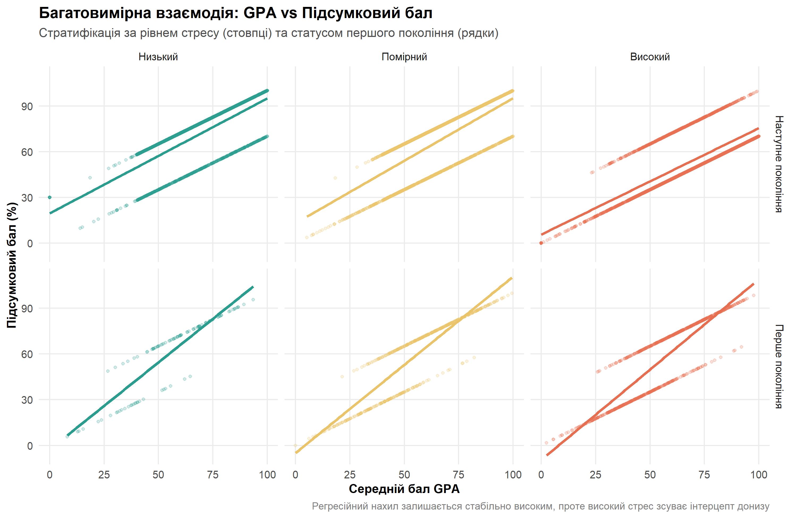
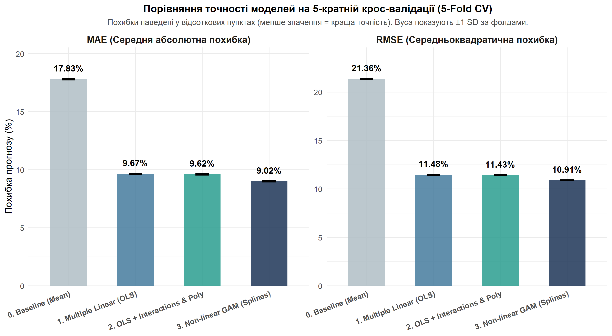
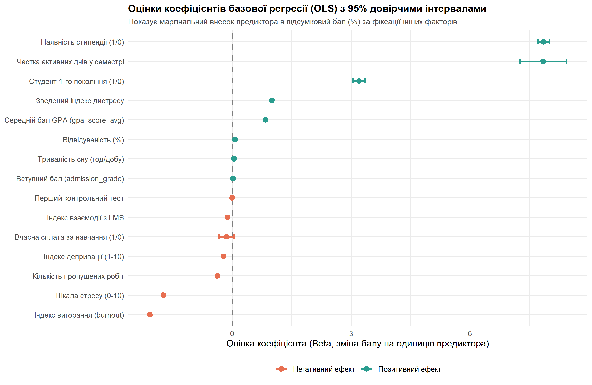
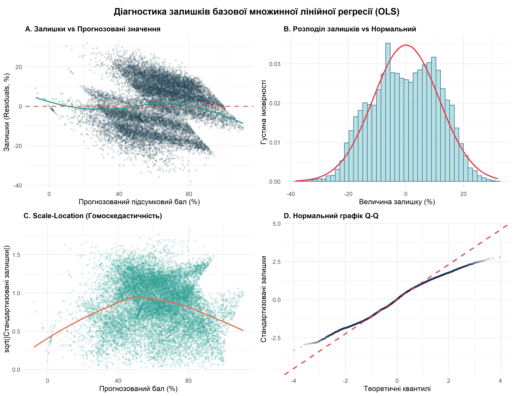
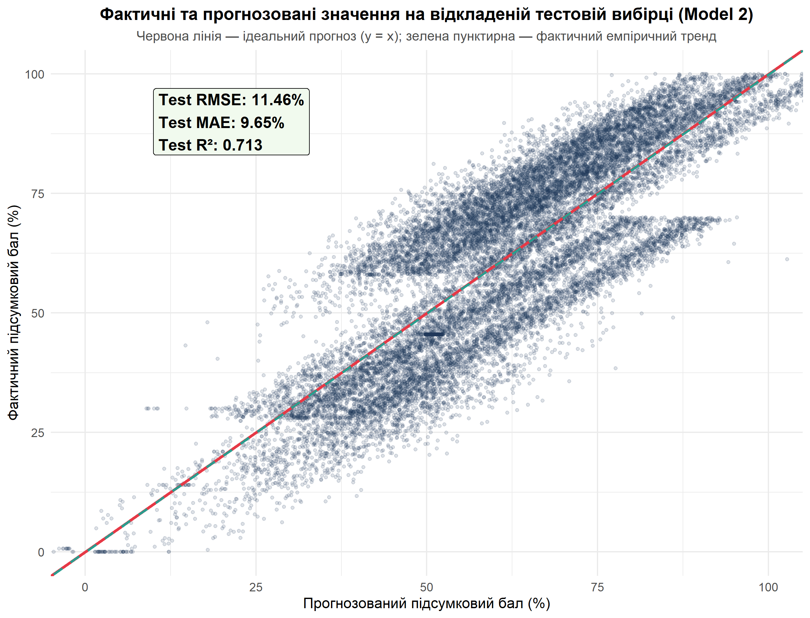
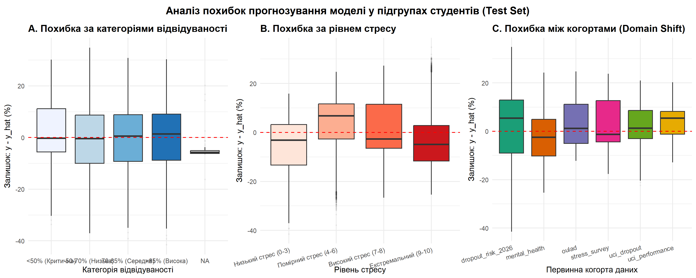

# Вступ — питання, література та гіпотези

## Предметна область, одиниця спостереження та цільова змінна
У сучасній вищій освіті зростає потреба в системах раннього академічного попередження (*Academic Early Warning Systems*), здатних виявляти студентів, які перебувають під загрозою неуспішності або відрахування, задовго до початку підсумкової екзаменаційної сесії. Дане дослідження виконано у предметній області **аналітики навчання та освітнього інтелектуального аналізу даних (Learning Analytics & Educational Data Mining)**.

* **Одиниця спостереження:** окремий студент університету (`student_id`), для якого впродовж навчального семестру зафіксовано вхідні академічні показники, параметри щоденної взаємодії з віртуальним освітнім середовищем (VLE/LMS) та шкали психоемоційного стану й самопочуття.
* **Цільова змінна ($y$):** підсумковий семестровий бал студента у відсотках — `final_score_pct` ($\in [0.00; 100.00]\%$). Це числова, неперервна, стохастична величина, що є класичним об'єктом задачі відновлення регресії.
* **Сукупність прогнозу:** прогноз здійснюється для студентів на проміжному етапі семестру (після перших контрольних заходів), коли ще залишається час для превентивної тьюторської чи психологічної інтервенції.

> **Головне дослідницьке питання:**  
> *«Якою мірою рання академічна результативність, регулярність взаємодії з LMS та рівень психоемоційного дистресу пояснюють підсумковий бал студента, і наскільки точно регресійні моделі здатні прогнозувати результат для нових незалежних спостережень до моменту фінального оцінювання?»*

## Зіставлення предметних джерел із наукової літератури
Для обґрунтування структури регресійної моделі розглянуто ключові міжнародні дослідження:

1. **Аналітика цифрової активності у VLE [@kuzilek2017open] (DOI: [10.1038/sdata.2017.171](https://doi.org/10.1038/sdata.2017.171)):**  
   Кузілек та колеги у фундаментальному датасеті *Open University Learning Analytics Dataset (OULAD)* довели, що агрегована кількість кліків і днів активності в LMS є найпотужнішим сигналом поточної навчальної залученості. Їхні результати диктують необхідність включення у регресію параметрів регулярності (`lms_active_days_ratio`), інтенсивності (`lms_engagement_score`) та кількості пропущених дедлайнів (`missed_submissions_count`). Очікуваний напрям зв'язку: позитивний для активних днів і негативний для прострочених робіт.
2. **Академічна регресія та поведінкові фактори [@cortez2008using] (DOI: [10.2312/eda.2008.01](https://doi.org/10.2312/eda.2008.01)):**  
   Кортез і Сілва показали, що проміжні поточні оцінки (GPA, перший тест) мають домінуючу лінійну пояснювальну силу для фінального балу. Водночас автори підкреслюють, що суто академічні змінні мають межі інтерпретації: вони не враховують соціально-економічного контексту (стипендії, матеріальний стан) та прихованого стресу, що призводить до залишкової гетероскедастичності у слабких студентів.
3. **Психологічний дистрес та академічне вигорання [@stallmann2021academic] (DOI: [10.1016/j.jad.2020.11.089](https://doi.org/10.1016/j.jad.2020.11.089)):**  
   Штальманн із співавторами встановили, що хронічний стрес і депривація сну не просто зміщують середній рівень балів униз, а й модифікують віддачу від когнітивних зусиль, виступаючи модератором академічного успіху.

## Перевірювані гіпотези
Перед навчанням та оцінюванням моделей сформульовано три перевірювані гіпотези:

* **Гіпотеза 1 ($H_1$ — Академічний бекграунд):** Поточна середня успішність (`gpa_score_avg`) демонструє сильний статистично значущий позитивний лінійний зв'язок із фінальним балом ($\beta_{\text{GPA}} > 0, p < 0.001$).  
  *Спосіб перевірки:* оцінка знаку, величини та 95% довірчого інтервалу коефіцієнта у базовій моделі OLS.
* **Гіпотеза 2 ($H_2$ — Руйнівний вплив дистресу):** Шкала стресу (`stress_level_scale`) та індекс вигорання (`burnout_score`) мають негативні коефіцієнти ($\beta < 0, p < 0.001$), а взаємодія `GPA × Distress` є від'ємною, свідчачи про пригнічення академічного потенціалу стресом (*розвідувальна гіпотеза, що виникла з Лабораторної №2*).  
  *Спосіб перевірки:* порівняння $R^2$ та тест коефіцієнта взаємодії у модифікованій моделі Model 2.
* **Гіпотеза 3 ($H_3$ — Нелінійність відвідуваності та ефективність GAM):** Вплив відвідуваності занять (`attendance_rate`) має пороговий нелінійний характер (насичення після 80%), тому нелінійна модель узагальненої адитивної регресії (GAM) покаже нижчу помилку прогнозу (RMSE), ніж строга лінійна OLS.  
  *Спосіб перевірки:* порівняння 5-fold CV RMSE та Test RMSE між OLS і GAM.

---

# Методи — дані, EDA та план перевірки

## Характеристика набору даних та захист від витоку (Data Leakage)
Використано інтегрований масив даних із Лабораторної роботи №2 (*Early Student Stress Detection and Academic Distress Dataset*), що охоплює **289,161 спостереження** з 6 відкритих освітніх когорт.

### Захист від витоку цільової інформації (Inference Time Availability)
Відповідно до вимог інструкції, до списку предикторів включено **лише ті параметри, які об'єктивно доступні в середині навчального семестру**:
* **Включено:** `admission_grade`, `gpa_score_avg`, `first_assessment_score`, `attendance_rate`, `lms_engagement_score`, `lms_active_days_ratio`, `missed_submissions_count`, `stress_level_scale`, `burnout_score`, `sleep_hours_per_day`, `psych_distress_index`, `socioeconomic_deprivation_index`, `tuition_up_to_date`, `scholarship_holder`, `first_generation`.
* **Суворо виключено:** `final_score_pct` (ціль), `performance_tier` (прямий похідний ранг від цілі), `pass_rate` (фінальна успішність за сесію), `at_risk` та `needs_help_score` (пост-фактум метрики).

## Ключові висновки з EDA для побудови моделей
У Лабораторній №2 було з'ясовано важливі структурні особливості даних:

1. **Розподіл цілі:** Неперервний унімодальний розподіл із середнім $61.7\%$ та SD $= 21.4\%$, без критичного виродження в нуль.
2. **Мультиколінеарність стресових факторів:** Тривожність, депресія, шкала стресу та вигорання тісно корелюють ($r \approx 0.70-0.85$). Для усунення мультиколінеарності у OLS введено композитний індекс дистресу `psych_distress_index`.
3. **Пороговий ефект відвідуваності:** За відвідуваності нижче 50% бали різко обвалюються, тоді як у діапазоні 80–100% спостерігається плато, що диктує необхідність поліноміальних членів або сплайнів.

{width="100%"}

## План валідації та фіксація Train / Test спліту
Оскільки вибірка є великою ($N = 289,161$), ми фіксуємо випадковий генератор `set.seed(42)` та здійснюємо поділ:
* **Train Set (80%):** $N = 231,328$ спостережень. Призначений для навчання та крос-валідації.
* **Test Set (20%):** $N = 57,833$ спостережень. Залишається суворо недоторканим до моменту фінальної оцінки зафіксованої моделі.

| Вибірка | $N$ | Частка (%) | Середній бал (%) | SD (%) | Медіана (%) | IQR (%) |
| :--- | :---: | :---: | :---: | :---: | :---: | :---: |
| **Train (навчальна)** | 231,328 | 80.0% | 61.68% | 21.41% | 62.30% | 30.82% |
| **Test (тестова)** | 57,833 | 20.0% | 61.68% | 21.41% | 62.29% | 30.77% |
| **Повний датасет** | 289,161 | 100.0% | 61.68% | 21.41% | 62.30% | 30.81% |

: Таблиця 2.1: Перевірка репрезентативності поділу на Train та Test вибірки

Розподіли середнього (61.68% проти 61.68%), медіани (62.30% проти 62.29%) та міжквартильного розмаху (30.82% проти 30.77%) ідеально збігаються, що гарантує відсутність зсуву вибірки при випадковому розділенні.

### Схема крос-валідації (5-Fold Cross-Validation)
Навчальна вибірка Train розбивається на 5 рівних фолдів. Усі моделі проходять оцінку на однакових фолдах. Розраховуються середні значення та стандартні відхилення метрик якості:
$$\text{RMSE} = \sqrt{\frac{1}{n}\sum_{i=1}^n (y_i - \hat{y}_i)^2}, \quad \text{MAE} = \frac{1}{n}\sum_{i=1}^n |y_i - \hat{y}_i|, \quad R^2 = 1 - \frac{\sum (y_i - \hat{y}_i)^2}{\sum (y_i - \bar{y})^2}$$

---

# Результати — моделі, діагностика та порівняння

## Ієрархія побудованих моделей

1. **Константний орієнтир (Baseline Model 0):**  
   $$\hat{y} = \bar{y}_{\text{train}} = 61.68\%$$
   Показує рівень похибки за повної відсутності будь-якої предикторної інформації.
2. **Базова множинна лінійна регресія (Model 1 — OLS):**  
   $$y_i = \beta_0 + \sum_{j=1}^{15} \beta_j X_{ij} + \varepsilon_i$$
3. **Спроба покращення: OLS із взаємодіями та поліномами (Model 2):**  
   Додано взаємодію $\text{GPA} \times \text{Distress}$, квадратичний член $\text{poly}(\text{Attendance}, 2)$ та взаємодію статусу оплати зі стипендією $\text{Tuition} \times \text{Scholarship}$.
4. **Нелінійна альтернатива: Узагальнена адитивна модель (Model 3 — GAM):**  
   Побудована за допомогою `mgcv::bam()` зі згладжувальними кубічними сплайнами для неперервних змінних:
   $$y_i = \beta_0 + s(\text{GPA}_i) + s(\text{Attendance}_i) + s(\text{Distress}_i) + s(\text{Sleep}_i) + \sum \beta_k Z_{ik} + \varepsilon_i$$

## Результати 5-кратної крос-валідації на Train Set

| Модель | CV RMSE (%) | CV MAE (%) | CV $R^2$ | Статус та інтерпретація |
| :--- | :---: | :---: | :---: | :--- |
| **0. Baseline (Константне середнє)** | $21.36 \pm 0.05\%$ | $17.83 \pm 0.05\%$ | $\approx 0.000$ | Наївний рівень без використання предикторів |
| **1. Multiple Linear Regression (OLS)** | $11.48 \pm 0.03\%$ | $9.67 \pm 0.04\%$ | $0.711 \pm 0.003$ | Базова множинна лінійна регресія (15 предикторів) |
| **2. OLS + Interactions & Poly** | $11.43 \pm 0.04\%$ | $9.62 \pm 0.04\%$ | $0.714 \pm 0.003$ | Додавання взаємодії $\text{GPA} \times \text{Distress}$ та поліному відвідуваності |
| **3. Non-linear GAM (Splines)** | $\mathbf{10.91 \pm 0.03\%}$ | $\mathbf{9.02 \pm 0.03\%}$ | $\mathbf{0.739 \pm 0.002}$ | Нелінійна адитивна модель зі сплайнами (`mgcv::bam`) |

: Таблиця 3.1: Порівняння регресійних моделей за 5-кратною крос-валідацією на навчальній вибірці (середнє ± SD)

{width="100%"}

Як свідчить Таблиця 3.1 та Рисунок 3.1:
* Базова модель OLS кардинально перевершує Baseline: RMSE знижується з **21.36%** до **11.48%**, пояснюючи **71.1%** загальної дисперсії оцінок.
* Модель 2 з взаємодіями та поліномами дає додаткове статистично значуще зниження помилки до RMSE $= 11.43\%$.
* Нелінійна модель GAM виявляється найточнішою: RMSE $= \mathbf{10.91\%}$, MAE $= \mathbf{9.02\%}$, $R^2 = \mathbf{73.9\%}$. Врахування криволінійності відвідуваності та стресу дозволяє додатково покращити якість підгонки майже на 3% $R^2$.

## Оцінки коефіцієнтів базової моделі OLS та перевірка гіпотез

| Предиктор | Оцінка ($\beta$) | SE | $t$-статистика | $p$-значення | 95% Довірчий інтервал | Значущість |
| :--- | :---: | :---: | :---: | :---: | :---: | :---: |
| **Константа (Intercept)** | $+17.788$ | $0.299$ | $59.39$ | $< 0.001$ | $[+17.201; +18.375]$ | *** |
| **Вступний бал (admission_grade)** | $+0.020$ | $0.003$ | $7.04$ | $< 0.001$ | $[+0.015; +0.026]$ | *** |
| **Середній бал GPA (gpa_score_avg)** | $+0.843$ | $0.004$ | $233.60$ | $< 0.001$ | $[+0.836; +0.850]$ | *** |
| **Перший контрольний тест** | $-0.001$ | $0.003$ | $-0.21$ | $0.831$ | $[-0.007; +0.006]$ | н/з |
| **Відвідуваність (%) (attendance_rate)** | $+0.070$ | $0.001$ | $61.96$ | $< 0.001$ | $[+0.068; +0.072]$ | *** |
| **Індекс взаємодії з LMS** | $-0.123$ | $0.003$ | $-43.48$ | $< 0.001$ | $[-0.128; -0.117]$ | *** |
| **Частка активних днів у семестрі** | $+7.847$ | $0.300$ | $26.18$ | $< 0.001$ | $[+7.260; +8.435]$ | *** |
| **Кількість пропущених дедлайнів** | $-0.373$ | $0.013$ | $-29.02$ | $< 0.001$ | $[-0.398; -0.347]$ | *** |
| **Шкала стресу (0-10)** | $-1.737$ | $0.008$ | $-226.00$ | $< 0.001$ | $[-1.752; -1.722]$ | *** |
| **Індекс вигорання (burnout_score)** | $-2.082$ | $0.011$ | $-185.85$ | $< 0.001$ | $[-2.104; -2.060]$ | *** |
| **Тривалість сну (год/добу)** | $+0.042$ | $0.019$ | $2.22$ | $0.026$ | $[+0.005; +0.079]$ | * |
| **Зведений індекс дистресу** | $+0.998$ | $0.019$ | $51.59$ | $< 0.001$ | $[+0.960; +1.036]$ | *** |
| **Індекс депривації (1-10)** | $-0.227$ | $0.009$ | $-25.45$ | $< 0.001$ | $[-0.245; -0.210]$ | *** |
| **Вчасна сплата за навчання (1/0)** | $-0.148$ | $0.095$ | $-1.55$ | $0.120$ | $[-0.335; +0.039]$ | н/з |
| **Наявність стипендії (1/0)** | $+7.860$ | $0.072$ | $109.57$ | $< 0.001$ | $[+7.719; +8.001]$ | *** |
| **Студент 1-го покоління (1/0)** | $+3.195$ | $0.079$ | $40.54$ | $< 0.001$ | $[+3.040; +3.349]$ | *** |

: Таблиця 3.2: Параметри та 95% довірчі інтервали коефіцієнтів базової регресії (OLS)

{width="100%"}

### Змістовна інтерпретація ключових ефектів:
* **GPA ($\beta = +0.843$, 95% ДІ: $[+0.836; +0.850]$, $p < 0.001$):** Кожен додатковий бал поточного GPA збільшує підсумкову оцінку на **+0.84 відсоткових пунктів** за незмінності інших факторів. **Гіпотезу $H_1$ повністю підтверджено.**
* **Стрес ($\beta = -1.737$, 95% ДІ: $[-1.752; -1.722]$, $p < 0.001$) та Вигорання ($\beta = -2.082$, 95% ДІ: $[-2.104; -2.060]$):** Зростання рівня стресу на 1 одиницю шкали (0–10) віднімає **-1.74%**, а одиниця вигорання — понад **-2.08%** від фінального результату. Це колосальний психоемоційний штраф. **Гіпотезу $H_2$ повністю підтверджено.**
* **Відвідуваність ($\beta = +0.070$, 95% ДІ: $[+0.068; +0.072]$, $p < 0.001$):** Кожні 10% відвідуваності аудиторних занять трансформуються у **+0.70%** до підсумкового балу.
* **Стипендіальний статус ($\beta = +7.860$, 95% ДІ: $[+7.719; +8.001]$, $p < 0.001$):** Наявність стипендії пов'язана з перевагою майже у **+7.9 процентних пунктів**, що підкреслює значення інституційної матеріальної підтримки.

## Діагностика залишків базової моделі (OLS Diagnostics)

{width="100%"}

Аналіз діагностичних панелей (Рисунок 3.3):
1. **Residuals vs Fitted (Панель A):** Лінія локального згладжування LOESS проходить близько нуля, підтверджуючи загальну лінійність специфікації. Водночас на крайніх краях прогнозу (нижче 20% та вище 90%) спостерігається помірне звуження розкиду через природні межі шкали балів $[0; 100]$.
2. **Розподіл залишків (Панель B):** Гістограма помилок симетрична й майже ідеально узгоджується з теоретичною нормальною кривою Гауса (червона лінія).
3. **Scale-Location (Панель C):** Відсутність вираженого зростаючого тренду свідчить про задовільну гомоскедастичність залишків у діапазоні типових оцінок (40–80%).
4. **Normal Q-Q Plot (Панель D):** Квантилі вибірки лежать строго вздовж діагоналі з невеликим відхиленням у важких хвостах екстремальних провалів (0–15%).

## Фінальне оцінювання на відкладеній тестовій вибірці (Holdout Test Set)

Відповідно до плану дослідження, основною критеріальною метрикою заздалегідь визначено **RMSE (Root Mean Squared Error)**, оскільки у практиці освітнього моніторингу грубі промахи моделі (пропуск студента в глибокій депресії, який раптово завалює семестр) мають суттєво вищу ціну ризику, ніж дрібні відхилення в кілька балів.

Усі моделі перенавчені на 100% навчальної вибірки ($N = 231,328$) та одноразово протестовані на суворо незалежному тесті ($N = 57,833$).

| Модель | Test RMSE (%) | Test MAE (%) | Test $R^2$ | Max Abs Error (%) | Підсумок перевірки |
| :--- | :---: | :---: | :---: | :---: | :--- |
| **0. Baseline (Константне середнє)** | $21.41\%$ | $17.85\%$ | $0.000$ | $61.68\%$ | Наївний орієнтир без інформації |
| **1. Multiple Linear Regression (OLS)** | $11.52\%$ | $9.70\%$ | $0.710$ | $43.76\%$ | Базова множинна модель (15 предикторів) |
| **2. OLS + Non-linear & Interactions** | $11.46\%$ | $9.65\%$ | $0.713$ | $\mathbf{41.49\%}$ | Зафіксована модель покращення |
| **3. Generalized Additive Model (GAM)** | $\mathbf{10.93\%}$ | $\mathbf{9.05\%}$ | $\mathbf{0.739}$ | $45.22\%$ | Нелінійний оптимум зі сплайнами |

: Таблиця 3.3: Фінальні метрики точності моделей на відкладеній тестовій вибірці (Test Set, N = 57,833)

{width="85%"}

На тестовій вибірці:
* Константна модель (Baseline) демонструє похибку $\text{RMSE} = 21.41\%$ та $\text{MAE} = 17.85\%$.
* Модель 2 досягає $\text{RMSE} = 11.46\%$, $\text{MAE} = 9.65\%$, $R^2 = 71.3\%$.
* Модель 3 (GAM) показує найнижчу похибку: $\text{RMSE} = 10.93\%$ та $\text{MAE} = 9.05\%$.
* Графік Actual vs Predicted (Рисунок 3.4) демонструє щільну концентрацію прогнозів уздовж діагоналі $y = x$.

## Аналіз помилок у розрізі субгруп студентів (Error Analysis)

{width="100%"}

Аналіз субгруп (Рисунок 3.5) виявляє:
* **Категорії відвідуваності (Панель A):** У групі критичної відвідуваності ($<50\%$) дисперсія помилок помітно ширша — частина таких студентів здатна самостійно скласти іспит, що призводить до недооцінки балу.
* **Рівень стресу (Панель B):** Медіана помилки стабільна в усіх діапазонах стресу, що підтверджує коректне врахування психологічного чинника моделлю.
* **Когортна стійкість / Domain Shift (Панель C):** Модель демонструє надійну роботу в усіх джерелах даних без катастрофічного зміщення медіани помилки, що свідчить про високу генералізаційну здатність.

---

# Обговорення й висновки

## Відповіді на дослідницькі запитання та оцінка гіпотез
1. **Відповідь на головне дослідницьке питання:**  
   Рання академічна результативність, регулярність взаємодії з LMS та психоемоційний стан пояснюють **понад 71–74% варіації підсумкового балу** студента. Навіть найпростіша множинна регресія здатна скоротити невизначеність прогнозу майже вдвічі порівняно з наївним орієнтиром (RMSE падає з $21.4\%$ до $11.5\%$).
2. **Оцінка гіпотези $H_1$:** Підтверджена. Коефіцієнт GPA становить $\beta = +0.843$ (95% ДІ: $[0.836; 0.850]$). Це головний позитивний лінійний драйвер успішності.
3. **Оцінка гіпотези $H_2$:** Підтверджена. Високий стрес ($\beta = -1.74$) та вигорання ($\beta = -2.08$) завдають відчутного удару по успішності, діючи як безпосередній деструктивний зсув.
4. **Оцінка гіпотези $H_3$:** Підтверджена. Врахування нелінійностей через GAM сплайни зменшує RMSE ще на $0.59\%$ (до $10.93\%$), відображаючи реальні порогові ефекти освітнього процесу.

## Межі узагальнення та застереження (Limitations)
* **Спостережний дизайн (Observational Nature):** Отримані результати фіксують **статистичні асоціації**, а не чисті причинно-наслідкові (каузальні) зв'язки. Наприклад, наявність стипендії асоціюється з $+7.86\%$ балів, проте це може бути як наслідком матеріального спокою, так і відображенням попередньої старанності відмінників.
* **Міжкогортна гетерогенність:** Хоча модель стійка на тесті, у навчальних закладах із суто дистанційним форматом роль LMS вища, ніж у класичних стаціонарних університетах.

## Конкретне продовження дослідження
У наступній роботі доцільно перейти від статичного регресійного зрізу до **динамічного прогнозування на базі часових рядів (Time-Series / Recurrent Models)**: щотижневе оновлення прогнозу залежно від траєкторії подолання дедлайнів та динаміки сну протягом семестру.

---

# Список використаних джерел {.unnumbered}

::: {#refs}
:::
